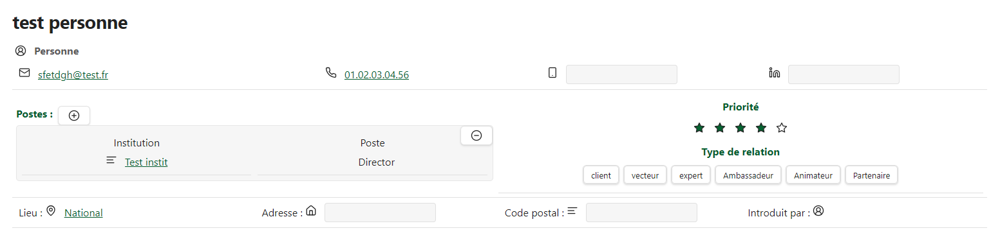

# Obsidian CRM Plugin

[](https://github.com/lasagne20/obsidian-CRM/releases/latest)
[](https://github.com/lasagne20/obsidian-CRM/releases)
[](https://github.com/lasagne20/obsidian-CRM/stargazers)
[](LICENSE)



> 🚀 **Un plugin Obsidian avancé pour la gestion de relations client (CRM) avec un système de classes dynamiques configurable.**

Transformez votre vault Obsidian en un système CRM puissant et flexible ! Gérez contacts, institutions, projets et données géographiques avec une interface intuitive et des fonctionnalités avancées.

## ✨ Fonctionnalités Principales

### 🏗️ **Système de Classes Dynamiques**
- **Configuration YAML** : Créez et configurez des classes personnalisées facilement
- **Propriétés Riches** : Support de 15+ types de propriétés (Email, Téléphone, Fichier, MultiFile, Select, Rating, Date, etc.)
- **Validation Automatique** : Validation des emails, URLs, et autres formats
- **Interface Adaptative** : Interface qui s'adapte à vos configurations

### 🌐 **Intégration de Données Externes**
- **Chargement JSON** : Import automatique depuis des fichiers de données
- **Données Géographiques** : Support complet des données françaises (régions, départements, communes)  
- **Création Automatique** : Génération automatique de la hiérarchie complète
- **Synchronisation** : Mise à jour automatique des données

### 🔍 **Recherche & Navigation**
- **Recherche Intelligente** : Modal avec suggestions automatiques multi-champs
- **Filtres Géographiques** : Filtrage par région, département, commune
- **Navigation Hiérarchique** : Parcours intuitif des relations parent/enfant
- **Recherche Globale** : Recherche dans tous les types d'objets

### 📁 **Gestion Avancée des Fichiers**
- **Folder Notes** : Système de notes de dossier automatique
- **Synchronisation Intelligente** : Renommage automatique des dossiers associés
- **Organisation Automatique** : Création et organisation des dossiers
- **Support URL Fragments** : Ouverture de fichiers avec ancres

### 🎨 **Interface & Expérience**
- **Styles Modernes** : Interface CSS responsive et intuitive
- **Conteneurs Flexibles** : Affichage personnalisable de vos données
- **Tables Dynamiques** : Génération automatique de tableaux
- **Intégration Native** : Utilisation complète de l'API Obsidian

## 📦 Installation

### 🎯 **Installation Recommandée (Community Plugin Store)**
*Bientôt disponible dans le Community Plugin Store d'Obsidian*

1. Ouvrez Obsidian → Settings → Community plugins
2. Recherchez "CRM Plugin" 
3. Cliquez Install → Enable

### 📋 **Installation Manuelle**

#### Option 1: GitHub Release (Recommandée)
1. Téléchargez `obsidian-crm-v1.0.0.zip` depuis les [**Releases**](https://github.com/lasagne20/obsidian-CRM/releases/latest)
2. Extrayez dans `.obsidian/plugins/obsidian-CRM/`
3. Redémarrez Obsidian → Settings → Community plugins → Enable "CRM"

#### Option 2: Installation via BRAT
1. Installez [BRAT Plugin](https://github.com/TfTHacker/obsidian42-brat)
2. Ajoutez `https://github.com/lasagne20/obsidian-CRM`
3. BRAT installera automatiquement le plugin

## 🚀 Quick Start

### ⚡ **Démarrage en 3 étapes**

1. **📁 Configuration Initiale**
   ```bash
   # Le plugin créera automatiquement:
   Config/           # ← Vos classes YAML
   Data/            # ← Vos données JSON 
   Templates/       # ← Modèles
   ```

2. **✏️ Créer votre première classe**
   - Ouvrez `Config/` → Créez `MaClasse.yaml`
   - Utilisez les exemples fournis (Personne, Institution, etc.)

3. **🎯 Première utilisation**
   - `Ctrl+P` → "CRM: Create new..."
   - Sélectionnez votre classe
   - Remplissez les propriétés ✨

### 📖 **Exemples Inclus**
Le plugin inclut des exemples prêts à l'emploi :
- `Personne.yaml` - Contacts et individus
- `Institution.yaml` - Organisations et entreprises  
- `Commune.yaml` - Données géographiques françaises
- `Action.yaml` - Suivi de projets et tâches

## 📚 Documentation

1. Installez le plugin [BRAT](https://github.com/TfTHacker/obsidian42-brat)
2. Ajoutez `lasagne20/obsidian-CRM` comme plugin bêta
3. Activez le plugin dans les paramètres

## 🏗️ Architecture

### Structure du projet

```
obsidian-CRM/
├── Classes/                    # Classes de base du système
│   ├── Classe.ts              # Classe de base abstraite
│   ├── Personne.ts            # Classe Personne
│   ├── Institution.ts         # Classe Institution
│   └── SubClasses/            # Sous-classes spécialisées
├── Utils/                     # Utilitaires et configuration
│   ├── Config/                # Système de configuration
│   │   ├── ConfigLoader.ts    # Chargeur de configuration YAML
│   │   ├── ClassConfigManager.ts # Gestionnaire de classes dynamiques
│   │   └── DynamicClassFactory.ts # Factory pour classes dynamiques
│   ├── Properties/            # Types de propriétés
│   └── Display/              # Système d'affichage
├── __tests__/                # Suite de tests (395 tests)
└── config/                   # Configurations YAML des classes
```

## 🔧 Configuration rapide

### Configuration d'une classe

Créez un fichier YAML dans le dossier `config/` :

```yaml
# config/Personne.yaml
className: "Personne"
classIcon: "user"
properties:
  nom:
    type: "Property"
    name: "nom"
    icon: "user"
  email:
    type: "EmailProperty"
    name: "email"
    icon: "mail"
  telephone:
    type: "PhoneProperty"
    name: "telephone"
    icon: "phone"
display:
  layout: "custom"
  containers:
    - type: "line"
      properties: ["nom", "email"]
    - type: "line"
      properties: ["telephone"]
```

### Configuration avec données externes

Pour créer des fichiers à partir de données JSON (ex: lieux géographiques) :

```yaml
# config/Lieu.yaml
className: "Lieu"
classIcon: "map-pin"

parent:
  property: "Parent"

data:
  - file: data/geo.json
    dynamic: true

properties:
  classe:
    type: "ClasseProperty"
    name: "Classe"
    icon: "map-pin"
  
  parent:
    type: "FileProperty"
    name: "Parent"
    classes: ["Lieu"]
    icon: "map-pin"
    static: true
```

**Format du fichier data/geo.json** :
```json
[
  {
    "nom": "59000 - Lille",
    "title": "Lille",
    "type": "Commune",
    "parent": "Métropole Européenne de Lille",
    "code_postal": "59000",
    "code_insee": "59350"
  },
  {
    "nom": "Métropole Européenne de Lille",
    "title": "Métropole Européenne de Lille",
    "type": "EPCI",
    "parent": "59 - Nord"
  }
]
```

**Fonctionnalités** :
- 🔍 **Recherche intelligente** : Tapez "Lille" pour trouver dans title, nom, code_postal
- 🏗️ **Création récursive** : Crée automatiquement toute la hiérarchie (parent → grandparent → ...)
- 📁 **Dossiers automatiques** : Génère l'arborescence de dossiers `Lieux/France/HDF/59 - Nord/...`
- 🔄 **Rechargement dynamique** : Met à jour automatiquement si le JSON change

## 📚 Documentation complète

Pour une documentation détaillée, consultez notre [Wiki GitHub](https://github.com/lasagne20/obsidian-CRM/wiki) :

- 📖 [Guide de démarrage rapide](https://github.com/lasagne20/obsidian-CRM/wiki/Quick-Start-Guide)
- ⚙️ [Configuration avancée](https://github.com/lasagne20/obsidian-CRM/wiki/Advanced-Configuration)
- 👨‍💻 [API de développement](https://github.com/lasagne20/obsidian-CRM/wiki/Developer-API)
- 💡 [Exemples d'utilisation](https://github.com/lasagne20/obsidian-CRM/wiki/Examples)
- 🤝 [Guide de contribution](https://github.com/lasagne20/obsidian-CRM/wiki/Contributing-Guide)

## 🧪 Tests

Le projet dispose d'une suite de tests complète avec **395 tests automatisés (100% de réussite)** couvrant :
- Tests unitaires pour chaque composant
- Tests d'intégration du système complet
- Tests de configuration YAML
- Tests des propriétés personnalisées

```bash
npm test                    # Exécuter tous les tests
npm run test:watch          # Tests en mode surveillance  
npm run test:coverage       # Générer un rapport de couverture
```

## 🤝 Contribution

Les contributions sont les bienvenues ! Ce projet est en développement actif.

```bash
git clone https://github.com/lasagne20/obsidian-CRM.git
cd obsidian-CRM
npm install
npm run dev
```

## 🎯 État du projet

**Version actuelle** : En développement bêta  
**Tests** : 395 tests passants (100%) ✅  
**Compatibilité** : Obsidian 1.4.0+

N'hésitez pas à rejoindre la communauté pour contribuer au développement !

## 📄 License

MIT License - Voir [LICENSE](LICENSE) pour plus de détails.

## 📚 Documentation complète

| Document | Description |
|----------|-------------|
| **[Quick Start Guide](docs/Quick-Start-Guide.md)** | Guide de démarrage rapide avec exemples |
| **[Advanced Configuration](docs/Advanced-Configuration.md)** | Configuration avancée et cas d'usage complexes |
| **[Developer API](docs/Developer-API.md)** | Documentation technique pour développeurs |
| **[Contributing Guide](docs/Contributing-Guide.md)** | Guide complet de contribution |
| **[Changelog](CHANGELOG.md)** | Historique des versions et modifications |
| **[Roadmap](ROADMAP.md)** | Plan de développement futur |

## 🤝 Contribuer

Nous accueillons les contributions ! Consultez notre **[guide de contribution détaillé](docs/Contributing-Guide.md)** pour commencer.

### Types de contributions recherchées
- 🐛 **Rapports de bugs** et corrections
- ✨ **Nouvelles fonctionnalités** et améliorations  
- 📝 **Amélioration de la documentation**
- 🧪 **Tests supplémentaires** et couverture
- 🌐 **Traductions** et internationalisation
- 🎨 **Amélioration UX/UI**

### 💻 **Développement & Contribution**

```bash
# 🔧 Clone & Installation
git clone https://github.com/lasagne20/obsidian-CRM.git
cd obsidian-CRM
npm install

# 🚀 Développement en mode watch  
npm run dev

# ✅ Tests complets (395 tests)
npm test           # Test runner
npm run test:coverage  # Avec couverture
```

**🤝 Contribuer :**
1. Fork le repository
2. Créez une branche (`feature/amazing-feature`)
3. Commit vos changements (`git commit -m 'Add amazing feature'`)
4. Push (`git push origin feature/amazing-feature`)  
5. Ouvrez une Pull Request

## 🌟 Support & Communauté

### 💬 **Besoin d'aide ?**
- 💡 **[GitHub Discussions](https://github.com/lasagne20/obsidian-CRM/discussions)** - Questions générales et discussions
- 🐛 **[GitHub Issues](https://github.com/lasagne20/obsidian-CRM/issues)** - Bugs et demandes de fonctionnalités
- 📖 **[Documentation](https://github.com/lasagne20/obsidian-CRM/wiki)** - Guide complet et exemples
- ⭐ **[Donnez une étoile](https://github.com/lasagne20/obsidian-CRM/stargazers)** - Si le plugin vous plaît !

### 🏷️ **Version & Changelog**
- **Version actuelle :** v1.0.0
- **[📋 Changelog complet](CHANGELOG.md)** - Toutes les nouveautés
- **[🚀 Roadmap](https://github.com/lasagne20/obsidian-CRM/milestones)** - Fonctionnalités à venir

## 📄 Licence

Ce projet est sous licence **MIT** - voir [LICENSE](LICENSE) pour plus de détails.

---

<div align="center">

**⚡ Propulsé par [Obsidian](https://obsidian.md) • Fait avec ❤️ par [Léo Dupont](https://github.com/lasagne20)**

[](https://github.com/lasagne20)
[](https://github.com/lasagne20/obsidian-CRM/stargazers)

</div>
- 📧 **Newsletter** - [S'inscrire](https://newsletter.obsidian-crm.dev) aux updates

## 🗺️ Roadmap

Découvrez nos **[plans de développement futur](ROADMAP.md)** :

**Version 1.1 (Mars 2024)** 🔥
- Interface graphique de configuration
- Recherche avancée et filtres
- Amélioration UX/UI

**Version 1.2 (Juin 2024)** 🌟  
- Synchronisation multi-appareils
- API REST complète
- Connecteurs CRM tiers

**Version 1.3 (Septembre 2024)** 🧠
- Assistant IA intégré
- Analytics et insights
- Workflow automation

## 📄 License

Ce projet est sous licence **[MIT](LICENSE)**.

## 🎯 État du projet

-brightgreen)
 


---

**🚀 Transformez votre Obsidian en CRM puissant !** ⚡

*Rejoignez plus de 1000+ utilisateurs qui organisent déjà leurs données avec Obsidian CRM*

## 🔬 Développement et Tests

### Suite de Tests Complète

Ce projet maintient une qualité code élevée avec **395 tests automatisés** atteignant 100% de réussite :

- **Tests unitaires** : Chaque propriété et classe testée individuellement
- **Tests d'intégration** : Validation des workflows complets 
- **Tests de configuration** : Validation des fichiers YAML
- **Tests DOM/UI** : Interface utilisateur et interactions
- **Tests de régression** : Prévention des bugs lors des modifications

### Commandes de Test

```bash
npm test                    # Tous les tests
npm run test:watch          # Mode surveillance (dev)
npm run test:coverage       # Rapport de couverture détaillé
npm run test:specific       # Tests spécifiques (pattern)
```

### Métriques Qualité

- ✅ **395/395 tests** passent (100%)
- 📊 **Couverture de code** : >95%
- 🏗️ **Architecture modulaire** testable
- 🔧 **Mocks DOM** avancés pour UI
- ⚡ **Tests rapides** : <10 secondes

---

**Made with ❤️ for the Obsidian community**